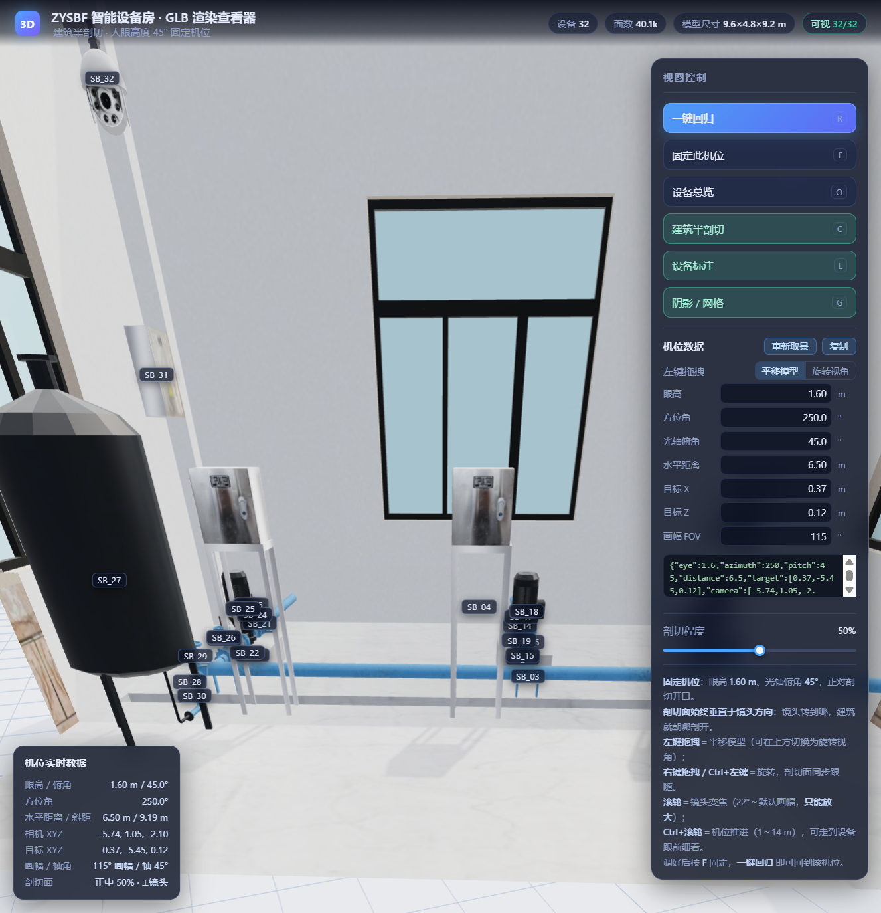

# ZYSBF 智能设备房 · GLB 三维查看器

基于 **three.js** 的 `zysbf.glb` 渲染查看器：建筑**半剖切** + **人眼高度 1.6 m / 俯角 45° 固定机位** + **一键回归**。



---

## 一、快速开始

GLB 必须经 HTTP 读取（浏览器禁止 `file://` 协议 fetch 本地模型），因此项目自带一个零依赖静态服务器：

```bash
cd E:\person\glb
npm start            # 等价于 node server.js
```

然后浏览器打开 **http://127.0.0.1:8899/** 即可。

> 也可以用任意静态服务器，例如 `python -m http.server 8899`。
> three.js 已内置在 `vendor/three/`（离线可用），无需联网、无需 `npm install`。

## 二、目录结构

```
E:\person\glb
├── index.html              查看器页面（UI + importmap）
├── app/viewer.js           three.js 场景、剖切、机位求解、交互
├── server.js               本地静态服务器（npm start）
├── vendor/three/           内置 three.js r170 + GLTFLoader/OrbitControls/RoomEnvironment
├── zysbf.glb               模型文件（5.0 MB，Blender 导出）
└── package.json
```

## 三、模型结构（自动解析，无需手工配置）

`zysbf.glb` 顶层为 33 个节点，查看器按命名自动分组：

| 节点 | 含义 | 处理方式 |
|---|---|---|
| `ZYSBF` | 建筑外壳（10 个分件：墙体、屋面、地坪、门、窗、门廊） | **施加裁剪面**（半剖切） |
| `ZYSBF_SB_01` … `ZYSBF_SB_32` | 32 台设备（管道、阀门、水泵、控制柜、罐体、墙面表箱等） | **不裁剪**，始终完整可见 |

- 建筑外轮廓 **9.6 × 4.8 × 9.2 m**，室内地坪 `y = -0.55 m`，约 8.3 × 8.6 m 的设备间。
- 地坪由「覆盖大部分建筑面积的薄板」自动识别，剖切时**地坪不参与裁剪**，设备不会悬空。

## 四、机位数据模型（可编辑 / 可自由探索）

机位用 7 个可编辑的数值完整描述，任何一项改动都立即驱动相机：

| 字段 | 含义 | 单位 |
|---|---|---|
| **眼高** | 相机相对室内地坪（`y = -0.55`）的高度 | m |
| **方位角** | 水平朝向，0° = +Z，顺时针为正 | ° |
| **光轴俯角** | 相机光轴向下倾角（45° = 正对房间地面） | ° |
| **水平距离** | 相机到目标点的水平距离 | m |
| **目标 X / Z** | 目标点世界坐标（目标点高度由俯角自动推算） | m |
| **画幅 FOV** | 画幅垂直视场角（镜头焦距） | ° |

由这组数据可完全还原相机位置 `相机 = (目标X + 距离·sin方位角, 地坪+眼高, 目标Z + 距离·cos方位角)`，
光轴指向目标点。

### 鼠标操作（实时反馈）

| 操作 | 效果 | 限制 |
|---|---|---|
| **左键拖拽** | 默认为 **平移模型**：沿地面挪动画面，相机与目标点同步平移、视角不变 → 同样放大倍数下可把画面移到房间各处看周边设备 | 可在面板「左键拖拽」切换为「旋转视角」 |
| **右键拖拽 / Ctrl+左键** | 绕目标点旋转（方位角 360° 无限制，垂直方向限制在相机不穿地坪） | — |
| **滚轮** | **镜头变焦**：画幅变窄 → 设备等比放大（针孔成像，比例恒定、不变形） | 22°～默认画幅：**只能放大，设备不会被缩得比默认更小** |
| **Ctrl + 滚轮** | **机位推进**：沿水平方向真正走近设备细看（眼高与俯角锁定） | 1.0～14.0 m |
| **中键** | 禁用 | — |

> 平移是**沿地面的纯平移**：机位与目标点一起挪动，眼高、俯角、方位角、放大倍数全部保持不变，
> 所以「同样的放大倍数下移动查看周边设备」完全成立；机位数据里只有目标 X/Z 变化，其余不动。

### 剖切面始终垂直于镜头

剖切面的法线实时取自**相机当前方位角**，平面过建筑几何中心并垂直于视线方向，
所以镜头转到哪，建筑就朝哪剖开——始终是「朝镜头剖开」的剖视状态（HUD 里的 `剖切面 … ⟂镜头` 即为此状态标识）。
该状态在左键旋转、右键旋转、Ctrl+左键旋转、方位角数值输入等所有改变视角的路径下都会同步更新。

> 两种缩放刻意分成独立通道：**镜头**负责放大看细节（不会变形），
> **机位**负责换观察距离（能走到跟前）。两者互不干扰，也都受上下限约束——
> 设备不会被无限缩小，也不会把机位推到看不见模型的地方。

每帧把相机状态**反算**回上述 7 个字段并刷新：
- 右侧「机位数据」输入框实时更新（正在编辑的输入框不会被覆盖）
- 左下角 HUD 实时显示：眼高/俯角、方位角、水平距离/斜距、相机 XYZ、目标 XYZ、画幅/轴角、剖切面
- 面板下方 JSON 文本框实时输出可复制的机位数据

### 移轴取景（为什么不形变）

画面用的是**移轴镜头**：相机轴线仍保持 45° 俯角，但画幅在垂直方向整体平移，
使设备群充满画面（否则设备会挤在上缘、下半幅全是空地）。

关键点在于**取景参数是冻结的**——它只在「求解机位 / 一键回归 / 设备总览 / 手动点重新取景」时重算。
若每次鼠标操作都重新取景，画幅会跟着内容不停重排，缩放时看起来就像物体被拉伸变形。
冻结之后，缩放只改变机位，画面比例恒定。

旋转到新角度后内容可能偏离画幅中心，点面板上的 **「重新取景」** 即可按当前机位重新对焦。

### 固定最终机位

1. 鼠标调整到满意视角 → 按 **`F` / 「固定此机位」**（按钮变为「取消固定机位」并高亮，数据存入 `localStorage`，刷新页面仍然保留）
2. 「复制」按钮把当前机位数据以 JSON 形式复制到剪贴板（剪贴板不可用时自动全选文本框，可手动复制）
3. 任何时候按 **`R` / 「一键回归」** 即回到固定机位；若尚未固定，则回到求解出的标准机位（眼高 1.6 m、俯角 45°）

JSON 格式：

```json
{"eye":1.6,"azimuth":250,"pitch":45,"distance":6.5,
 "target":[0.37,-5.45,0.12],"camera":[-5.74,1.05,-2.1],"fov":78,"cut":50}
```

## 五、功能说明

### 1. 固定机位求解（首屏默认视角）

- **眼高 1.60 m**、**俯角 45°**，方位角与机位距离由求解器自动确定。
- 求解器在 36 个方位 × 0.15 m 步进距离上搜索，评分优先级：
  1. 设备完整入画数量（`full`）
  2. 部分入画数量（`partial`）
  3. 画面占用率
  4. 惩罚：单个设备贴脸遮挡、离设备过近、机位跑到室外空地、内容偏离画面中心
- 当前机位下 **32/32 台设备全部在画面内**（顶部状态栏「可视」实时统计）。

### 2. 离轴取景（为什么 45° 也能看清）

在眼高 1.6 m、俯角 45° 的物理约束下，「地面以上、视线以下」只覆盖约 0.3–9 m 的进深，
单纯对称视锥会让设备挤在画面上缘、下半幅全是空地。

查看器改用**离轴投影**（`camera.setViewOffset`）：先按设备实际张角求出内容范围，
再把画幅在垂直方向整体平移并按需收放，**相机轴线角度始终保持 45° 不变**，
只是相当于用移轴镜头重新裁切画幅——设备因此充满画面，且高位壁挂设备（SB_31 / SB_32）也能入画。

### 3. 建筑半剖切（随视角自动旋转）

- 裁剪面**垂直于视线方向、过建筑几何中心**，默认正好把建筑切成两半（近侧半边移除），远侧半边保留，
  形成标准的剖视开口；「剖切程度」滑块可在 0%（完整建筑）→ 50%（正中半切）→ 100%（外壳整体移除）之间连续调整。
- **剖切面跟随视角**：相机旋转时裁剪面同步绕建筑中心旋转，始终把靠近相机的一半切掉，
  所以无论转到哪个方位，房间都是剖开的、内部设备始终可见（实测 250° → 197° 旋转过程中「可视」始终 32/32）。
- 只对 `ZYSBF` 外壳材质设置 `clippingPlanes`，设备与地坪不受影响。
- 关闭剖切时求解器会自动把机位收进室内，避免被外墙挡住。

### 4. 其它控件

| 控件 | 说明 | 快捷键 |
|---|---|---|
| 一键回归 | 回到固定机位（或标准机位），并复位剖切、标注、阴影 | `R` |
| 固定此机位 | 固定 / 取消固定当前机位 | `F` |
| 重新取景 | 按当前机位重新对焦设备内容（刷新冻结的移轴取景） | — |
| 设备总览 | 抬高到 4.4 m、俯角 33°，俯瞰全房间布局 | `O` |
| 建筑半剖切 | 开/关剖切（关时自动回到室内机位） | `C` |
| 设备标注 | 设备编号气泡标签（HTML 叠加，随投影实时跟随） | `L` |
| 阴影 / 网格 | 阴影与场地网格开关 | `G` |
| 复制 | 把当前机位数据复制到剪贴板 | — |

## 六、调试参数

URL 查询参数可覆盖默认值，便于出图与复核：

| 参数 | 示例 | 含义 |
|---|---|---|
| `eye` | `?eye=4.4` | 眼高（m） |
| `pitch` | `?pitch=33` | 光轴俯角（°） |
| `fov` | `?fov=38` | 画幅垂直视场角（°） |
| `cut` | `?cut=0` | `0` = 关闭剖切 |
| `cutpos` | `?cutpos=100` | 剖切程度 0–100 |
| `labels` | `?labels=0` | 关闭标注 |
| `yaw` / `dist` | `?yaw=270&dist=5` | 强制方位角（度）与水平距离（m） |
| `parts` | `?parts=0,1,2` | 只剖切指定的外壳分件 |
| `debug` | `?debug=1` | 控制台输出分件包围盒与求解过程 |

> 已固定的机位会写入 `localStorage`（键名 `zysbf.pinnedView`），
> 刷新页面自动恢复；按 `F`「取消固定机位」可清除。

## 七、已知限制

- 浏览器需支持 WebGL2 与 ES Module（Chrome / Edge / Firefox / Safari 16+ 均可）。
- 剖切后墙体断面不封盖（three.js 裁剪面不做端面填充），近距离观察断面时可见墙体厚度，属于常规剖视表现。
- `SB_32` 位于墙高处（离地约 3.3 m），在「1.6 m 眼高 + 45° 俯角」下只能看到其下半段；
  需要看全貌请用「设备总览」（`O`），或手动把眼高调大、光轴俯角调小。
- 鼠标垂直旋转被限制在「相机不穿到地面以下」，需要更低视角请直接编辑「眼高」数值（可为负值）。

